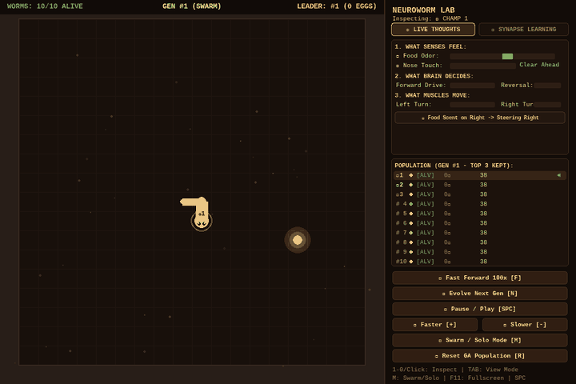

# NeuroWorm Snake

> A Snake player wired like a tiny worm's brain — and an honest test of whether that wiring actually helps.



## What is This?

NeuroWorm Snake is an experimental project where a simulated biological brain plays the classic game of Snake. The brain is modeled directly on the nervous system of *Caenorhabditis elegans*, a 1-millimeter nematode worm whose 302 signal-passing units (neurons) and thousands of physical connections (synapses) were mapped in detail by biologists. Rather than training a modern artificial neural network with backpropagation, a genetic algorithm tunes 36 biological connection weights to see if real worm wiring provides emergent navigation and survival behavior.

## Results

To evaluate performance honestly, all agents were tested across **30 held-out random seeds** (seeds 1000–1029, completely disjoint from the seeds used during training). Each episode ran on a 20×20 grid with a 150-step starvation limit.

| Agent | Mean Score | 95% CI | Max | Zero-Score (%) | Mean Steps |
| :--- | :---: | :---: | :---: | :---: | :---: |
| Random walk | 0.10 ± 0.11 | ±0.11 | 1 | 90.0% | 49.8 |
| Greedy rule (no brain) | 34.60 ± 4.20 | ±4.20 | 60 | 0.0% | 519.1 |
| Full connectome + default genome | 2.07 ± 0.54 | ±0.54 | 7 | 3.3% | 146.0 |
| Full connectome + evolved genome | 2.47 ± 0.77 | ±0.77 | 8 | 10.0% | 167.7 |
| Connectome removed (36 isolated synapses) | 3.60 ± 1.08 | ±1.08 | 13 | 0.0% | 77.5 |
| Shuffled connectome wiring | 1.50 ± 0.26 | ±0.26 | 3 | 3.3% | 93.3 |

*(Data produced by the evaluation suite; see [docs/results.md](docs/results.md) and [docs/results.json](docs/results.json).)*

### Plain Interpretation

- **It beats random guessing:** The worm brain consistently forages for food, averaging ~2.47 points compared to 0.10 for random movement.
- **A 15-line rule beats it by a wide margin:** A simple greedy heuristic that steers toward food while avoiding immediate walls scores an average of 34.60 points (peaking at 60), demonstrating the upper ceiling of the game environment.
- **Scrambling or removing the real wiring barely matters:** When the entire 302-neuron background connectome is removed—leaving only the 36 hand-wired sensor and motor connections—performance actually improves slightly (3.60 vs 2.47). The published biological connectome does not measurably drive Snake gameplay.

## What I Learned

I originally built this project hoping that simulating a real biological nervous system would produce intelligent, emergent navigation in a game environment. However, when I built a rigorous, reproducible evaluation harness and ran ablation controls across 30 held-out seeds, the data told a different story: the 302-neuron background connectome was largely dead weight. The hand-crafted sensor inputs, heuristic motor threshold rules, and the 36 isolated subcircuit connections were doing virtually all the work.

Finding out that an initial claim does not hold up under controlled testing is one of the most useful outcomes in software and machine learning engineering. It prevents mistaking handcrafted heuristic scaffolding for emergent biological intelligence.

For a biological network to truly learn tasks like Snake, future work would need:
1. A symmetric, learned readout layer instead of hardcoded heuristic thresholds.
2. A fair sensory interface that does not handicap the biological network compared to rule-based baselines.
3. High-resolution biological datasets that include inhibitory (negative) connection signs, rather than purely positive weights.

## Quick Start

```bash
# 1. Install dependencies
pip install -e ".[dev]"

# 2. Run the interactive demo (worm brain controls the snake)
python demo.py

# 3. Play manually with arrow keys
python demo.py --human

# 4. Run the reproducible 30-seed evaluation harness
python eval.py
```

*(To train new synaptic weights in headless mode: `python train_ga.py --generations 20`)*

## How It Works

```
┌────────────────┐      ┌─────────────────────────┐      ┌───────────────────────────┐      ┌─────────────────┐
│   Game State   │ ───> │     Sensory Encoder     │ ───> │    302-Neuron Network     │ ───> │  Motor Decoder  │ ───> Move
│ (Head, Food)   │      │ (Current Injections nA) │      │ (LIF Dynamics & Synapses) │      │ (Turn Decision) │
└────────────────┘      └─────────────────────────┘      └───────────────────────────┘      └─────────────────┘
```

1. **Game State**: Tracks snake head, body, and food positions on a 20×20 grid.
2. **Sensory Encoder**: Converts relative food angle and adjacent obstacles into electrical currents injected into sensory neurons (`ASEL`/`ASER` for food, `ASHL`/`ASHR`/`AVM` for danger).
3. **302-Neuron Connectome**: Simulates Leaky Integrate-and-Fire dynamics across all 302 neurons over 8 simulation timesteps (4.0 ms) per game frame.
4. **Motor Decoder**: Reads spike frequencies from command (`AVA`/`AVB`) and motor (`DB`/`VB`/`SMD`) neurons to decide the next direction.

For complete technical details, see [docs/how-it-works.md](docs/how-it-works.md).

### Interactive Controls

- `F`: Toggle 100x Fast-Forward off-screen neuroevolution
- `N`: Manually evolve the next generation
- `Space`: Pause / resume simulation
- `M`: Toggle 10-worm swarm roster vs solo champion view
- `F11`: Toggle fullscreen
- `+` / `-`: Increase or decrease playback speed

## Limitations

- **All connections are positive:** The published *C. elegans* CSV dataset contains only synapse weights, not neurotransmitter signs (all weights $\ge 1.0$). Real nervous systems rely on balanced excitation and inhibition; without inhibition, signals diffuse uncontrollably.
- **Unequal sensory access:** The greedy rule baseline inspects the entire 20×20 board to pathfind around obstacles, whereas the worm brain only senses immediate adjacent danger and relative food direction.
- **Small sample size:** 30 seeds give a reasonable 95% confidence interval, but the difference between default (2.07) and evolved (2.47) genomes remains within the margin of noise.
- **Hand-written decoding rules:** Turning decisions rely on hand-tuned threshold formulas rather than a learned readout layer.

## Glossary

- **Neuron**: A simple biological computational unit that accumulates electrical charge and fires a discrete spike when its voltage crosses a threshold.
- **Connectome**: The full physical wiring diagram showing all neurons and synaptic connections in an organism's nervous system.
- **Genetic Algorithm (GA)**: An optimization method inspired by natural selection that evaluates a population of candidate parameter sets, selects the top performers, and mutates them across generations.
- **Ablation / Control**: An experimental technique where parts of a system (such as the background wiring) are removed or randomized to measure their true effect on performance.

## References

- White et al. (1986) — *The structure of the nervous system of the nematode C. elegans*
- Varshney et al. (2011) — *Structural properties of the C. elegans neuronal network*
- Kunert et al. (2014) — *Multistability and long-timescale transients encoded by network structure in a model of C. elegans connectome dynamics*
- Gerstner & Kistler (2002) — *Spiking Neuron Models*

## License

MIT © 2026 NeurWorm Project Contributors — see [LICENSE](LICENSE)
