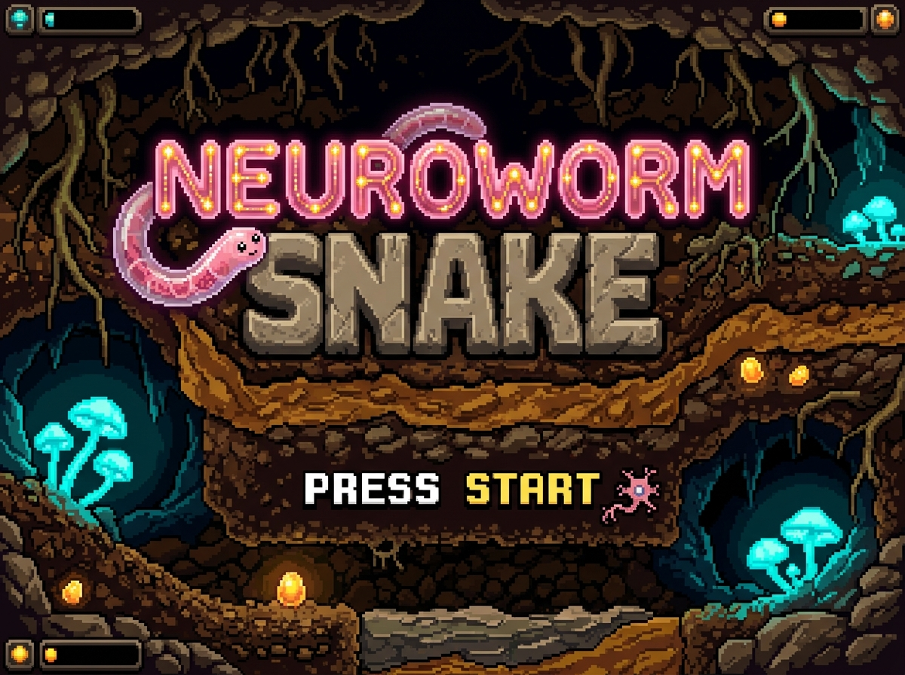
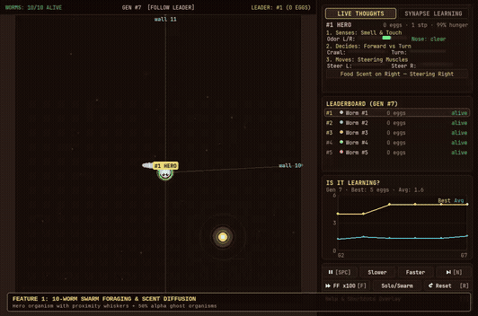
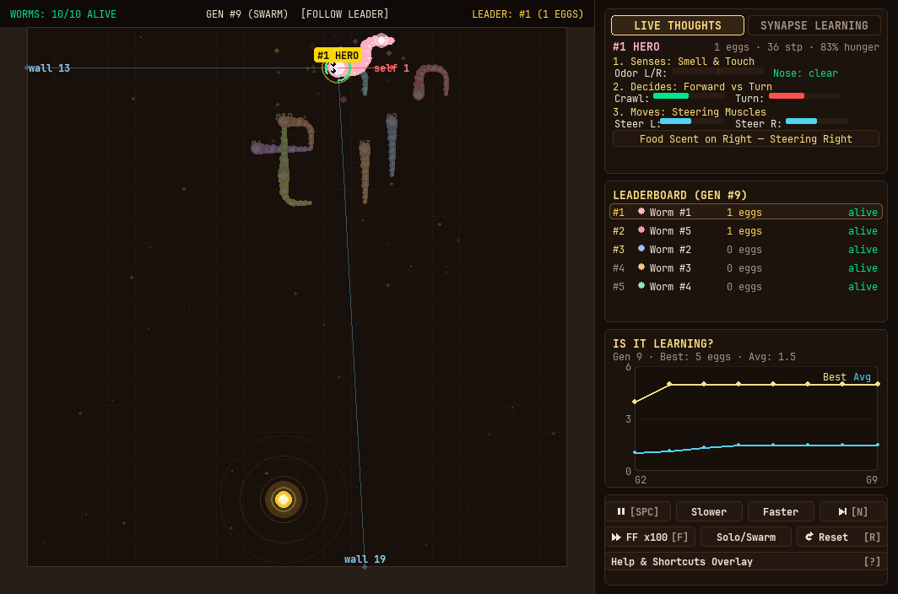

<h1 align="center">🪱 NeuroWorm Snake</h1>

<p align="center">
  <strong>Can a real worm brain survive a digital 2D Snake game?</strong><br>
  <em>A classic game of Snake powered by the real 302-neuron biological brain wiring of a microscopic worm — and an honest investigation into whether that biological wiring actually helps.</em>
</p>

<p align="center">
  
</p>

<p align="center">
  
  
  
  
  
</p>

<p align="center">
  
</p>

---

## Table of Contents

- [What is This?](#what-is-this)
- [How It Works (No Biology Degree Needed)](#how-it-works-no-biology-degree-needed)
  - [The 4-Step Information Pipeline](#the-4-step-information-pipeline)
  - [How a Biological Neuron Actually Fires](#how-a-biological-neuron-actually-fires)
  - [Sensory Whiskers and Scent Rings](#sensory-whiskers-and-scent-rings)
  - [Motor Muscles and the Hunger Clock](#motor-muscles-and-the-hunger-clock)
- [The Swarm Experiment (Neuroevolution)](#the-swarm-experiment-neuroevolution)
- [Scientific Findings: Does Biology Actually Help?](#scientific-findings-does-biology-actually-help)
  - [Benchmark Results Across 30 Held-Out Seeds](#benchmark-results-across-30-held-out-seeds)
  - [Key Discoveries & Why the Wiring Becomes "Dead Weight"](#key-discoveries--why-the-wiring-becomes-dead-weight)
- [Visual HUD & Telemetry Tour](#visual-hud--telemetry-tour)
  - [The Underground Arena](#the-underground-arena)
  - [The 3-Card Telemetry Dashboard](#the-3-card-telemetry-dashboard)
- [Interactive Keyboard Controls](#interactive-keyboard-controls)
- [Quick Start](#quick-start)
- [Project Architecture](#project-architecture)
- [Engineering Standards](#engineering-standards)
- [References & Scientific Literature](#references--scientific-literature)

---

## What is This?

**NeuroWorm Snake** is an experimental open-source project that places a biologically accurate simulation of a living creature's nervous system inside the classic game of Snake.

The brain is modeled on ***Caenorhabditis elegans*** (*C. elegans*), a 1-millimeter transparent roundworm found in garden compost. While human brains contain roughly 86 billion neurons, *C. elegans* has **exactly 302 neurons** and approximately 7,000 physical connections between them. In 1986, a landmark scientific team led by Sydney Brenner published the complete anatomical wiring diagram (the **"connectome"**) by hand-tracing thousands of electron microscope tissue slices. It remains one of the only organisms in history whose entire nervous system has been mapped at single-synapse resolution.

### How is This Different from Modern AI?

| Modern Artificial Intelligence (Deep Learning) | NeuroWorm Snake (Biophysical Simulation) |
| :--- | :--- |
| **Artificial neurons**: Simple mathematical numbers passed through linear matrix multiplications. | **Biophysical spiking neurons**: Simulates electrical voltages (in millivolts) and ion flows over time. |
| **Trained with backpropagation**: Millions of game frames adjust weights using calculus loss gradients. | **Zero backpropagation**: No training, no gradient descent, no loss functions. |
| **Black box architecture**: Millions of mysterious weights. | **Exact biological map**: 302 named neurons mapped from real biological laboratory data. |
| **Abstract math**: Requires powerful GPUs and gigabytes of memory. | **Pure physics & biology**: Runs in pure vectorized NumPy at over 60 frames per second. |

Rather than training a modern artificial neural network, we hook the worm's sensory neurons to the game world, simulate biological electrical pulses propagating through its 302-neuron connectome, and read its muscle motor neurons to steer the snake.

---

## How It Works (No Biology Degree Needed)

### The 4-Step Information Pipeline

Information travels through four distinct stages every single tick:

```
┌────────────────────────┐      ┌─────────────────────────┐      ┌───────────────────────────┐      ┌─────────────────┐
│ 1. Game Environment    │ ───> │ 2. Sensory Injections   │ ───> │ 3. 302-Neuron Connectome  │ ───> │ 4. Motor Decoders│ ───> Physical Move
│ (Head, Food, Obstacles)│      │ (Smell & Whiskers)      │      │ (Leaky Bucket Voltages)   │      │ (Turn Decision) │
└────────────────────────┘      └─────────────────────────┘      └───────────────────────────┘      └─────────────────┘
```

1. **Game Environment**: Tracks the snake's head coordinates, body segments, and golden food egg on a 20×20 subterranean grid.
2. **Sensory Injections**: Measures chemical distance to food and proximity to walls, injecting tiny electrical currents (in nanoamperes, nA) directly into the worm's sensory neurons.
3. **302-Neuron Connectome**: Simulates Leaky Integrate-and-Fire (LIF) physics across all 302 neurons, propagating electrical spikes across **3,709 chemical synapses** and **1,105 electrical gap junctions** over 8 biological sub-timesteps (4.0 ms) per game frame.
4. **Motor Decoders**: Measures firing frequencies in forward, reversal, and steering motor neurons to select the snake's next movement direction.

---

### How a Biological Neuron Actually Fires

You don't need a biology degree to understand a **Leaky Integrate-and-Fire** neuron. Think of every neuron as a **tiny leaky water bucket**:

```
           Incoming Electrical Signals (Rain)
                     │    │    │
                     ▼    ▼    ▼
             ┌───────────────────────┐
             │  Membrane Potential   │
             │   (Water in Bucket)   │ ──> Constant Leakage back to -65 mV
             └───────────────────────┘
                         │
             [ Water Hits Brim (-55 mV) ]
                         │
                         ▼
             💥 ACTION POTENTIAL SPIKE!
                         │
             - Electrical pulse sent down synapse
             - Bucket resets to -70 mV
             - 2 ms Refractory Rest Period
```

- **Resting Level (−65 mV)**: When nothing is happening, the neuron sits calmly at its resting membrane voltage.
- **Leaking**: If a small pulse enters, the voltage rises slightly, but steadily leaks back down toward −65 mV if no other signals follow.
- **Threshold Spike (−55 mV)**: If incoming signals arrive fast enough to fill the bucket past the −55 mV threshold, the neuron **fires an electrical spike (action potential)** down its branches to downstream neurons.
- **Reset & Refractory Period (−70 mV)**: Immediately after firing, the neuron dumps its voltage to −70 mV and enters a brief 2 millisecond rest period during which it cannot fire again.

---

### Sensory Whiskers and Scent Rings

In nature, a roundworm crawls through damp soil using two primary senses: **chemosensation** (smelling chemicals in the moisture) and **mechanosensation** (touching obstacles with its nose).

1. **Smelling the Egg (Chemosensation)**:
   - The golden bacterial egg emits an invisible chemical diffusion gradient in the soil (rendered on screen as 3 concentric golden ripples).
   - If the food is to the worm's left, sensory neuron **`ASEL`** (Anterior Sensory Excitatory Left) receives positive current.
   - If the food is to the right, sensory neuron **`ASER`** receives positive current.
   - Olfactory neurons **`AWAL`** and **`AWAR`** provide ambient motivation to encourage exploration.

2. **Sensory Whiskers (Touch & Proximity)**:
   - Three proximity whiskers project from the worm's head: **Front**, **Left**, and **Right**.
   - As an obstacle (granite boundary wall or snake tail segment) enters whisker range, anterior touch neurons **`AVM`** and **`ALM`** depolarize rapidly.
   - The on-screen whiskers change color dynamically from calm blue (safe) to amber (caution) and critical red (`wall 1` or `self 1`) when a collision is imminent.

---

### Motor Muscles and the Hunger Clock

Once signals pass through the 302-neuron network, the motor decoding stage reads spike counts from key output neurons:

- **Emergency Reversal (`AVA` vs `AVB`)**: If collision touch neurons fire intensely, command interneuron **`AVA`** (reversal reflex) overpowers **`AVB`** (forward crawling), forcing an immediate 90-degree escape turn.
- **Dorsal vs Ventral Steering (`DB` vs `VB`)**: Biological nematodes have muscles running along their back (dorsal) and belly (ventral). When dorsal motor neurons (**`DB`**) fire faster, the snake turns **UP**; when ventral motor neurons (**`VB`**) fire faster, it turns **DOWN**.
- **Head Steering (`SMD`)**: Sublateral head motor neurons (**`SMDDL`** vs **`SMDDR`**) control fine left and right directional steering.
- **Metabolic Hunger Clock**: Living worms must consume food to survive. Each worm has a 150-step metabolic energy reserve (visualized as a glowing circular arc around the hero worm's head). Eating an egg resets the clock to 150; letting it deplete to zero causes the organism to starve.

---

## The Swarm Experiment (Neuroevolution)

To explore whether biological wiring can adapt to Snake, the project runs a **10-worm competitive swarm** using a Genetic Algorithm:

```
Generation N: 10 Worm Swarm
  ├── Evaluated across 5 random food seeds (42, 107, 219, 333, 512)
  ├── 36 key synaptic conductances (nS) tuned per worm
  ├── Top 3 Champions preserved intact (Elitism)
  └── Remaining 7 slots repopulated with mutated offspring
```

- **Swarm Arena**: All 10 worms compete simultaneously. The leading champion is rendered in full vibrant color with a glowing cyan halo, while the other 9 swarm candidates appear as translucent ghosts (~50% opacity) with numeric identifiers.
- **Fair Multi-Seed Scoring**: Each candidate worm is evaluated across 5 distinct food seeds. This prevents a worm from receiving an inflated score simply by getting lucky with easy food placements.
- **Tuning 36 Real Biological Synapses**: Rather than altering the anatomy of all 7,000 connections, the evolutionary algorithm tunes **36 specific biological synaptic weights** connecting sensory neurons (`ASE`, `AVM`, `ASH`) to interneurons (`AIY`, `AVA`, `AVB`) and motor neurons (`DB`, `VB`, `SMD`).

---

## Scientific Findings: Does Biology Actually Help?

### Benchmark Results Across 30 Held-Out Seeds

To answer whether the 302-neuron biological brain actually provides intelligent navigation, all variants were rigorously benchmarked across **30 held-out random seeds** (seeds 1000–1029, completely isolated from training seeds).

| Agent Configuration | Mean Score | 95% Confidence Interval | Max Score | Zero-Score Rate (%) | Mean Survival Steps |
| :--- | :---: | :---: | :---: | :---: | :---: |
| **Random Walk** *(Pure random key presses)* | 0.10 ± 0.11 | ±0.11 | 1 | 90.0% | 49.8 |
| **Greedy Rule** *(15 lines of code, no brain)* | **34.60 ± 4.20** | ±4.20 | **60** | 0.0% | 519.1 |
| **Full Connectome + Default Genome** *(Un-evolved)* | 2.07 ± 0.54 | ±0.54 | 7 | 3.3% | 146.0 |
| **Full Connectome + Evolved Genome** *(10-worm GA)* | 2.47 ± 0.77 | ±0.77 | 8 | 10.0% | 167.7 |
| **Connectome Removed** *(36 isolated reflex synapses)* | **3.60 ± 1.08** | ±1.08 | **13** | **0.0%** | 77.5 |
| **Shuffled Connectome** *(Scrambled biological wiring)* | 1.50 ± 0.26 | ±0.26 | 3 | 3.3% | 93.3 |

*(Data generated via the automated evaluation suite; see [docs/results.md](docs/results.md) and [docs/results.json](docs/results.json).)*

---

### Key Discoveries & Why the Wiring Becomes "Dead Weight"

1. **It legitimately outperforms random chance**:
   The full biological worm brain averages **2.47 eggs** (surviving ~168 steps), whereas a random walk only manages **0.10 eggs** before crashing in under 50 steps. The sensory-motor wiring clearly guides the snake toward food and away from walls.

2. **A 15-line simple rule crushes the biological brain**:
   A basic greedy heuristic (steer toward the food, don't crash into walls) averages **34.60 eggs** and reaches up to 60 points, demonstrating the theoretical performance ceiling of the 20×20 board.

3. **The Big Surprise: Removing the Connectome Improves Performance!**:
   When we stripped away all 302 neurons in the background connectome—leaving behind **only the 36 direct sensory-to-motor reflex synapses**—the average score jumped from **2.47 to 3.60**, with a peak score of 13!

#### Why Did the Biological Wiring Hurt Performance?

In real biology, nervous systems depend on a precise balance of **excitation** (signals that trigger downstream firing) and **inhibition** (signals that suppress downstream firing). Think of it like a car having both an accelerator and a brake pedal.

However, the classic published *C. elegans* connectome dataset only documents physical connection locations and strengths—it does not indicate whether a synapse is excitatory or inhibitory. Consequently, all 3,709 chemical synapses are simulated with positive weights ($\ge 1.0$). 

Without biological brakes (inhibition), electrical pulses echo and reverberate across the 302 interconnected neurons like loud feedback in a tiled room. The complex background wiring became "dead weight" that blurred sensory information. The direct, 36-synapse reflex arc was doing all the real work.

> [!NOTE]
> **Engineering Honesty Over Hype:** Many projects claim that embedding a biological brain yields "emergent biological intelligence." Rigorous ablation testing revealed that the biological background wiring was not driving game performance. Transparently reporting these controls is fundamental to real engineering and scientific integrity.

---

## Visual HUD & Telemetry Tour

<p align="center">
  
</p>

### The Underground Arena

- **Subterranean Soil & Strata**: Custom pixel-art soil cross-section featuring root filaments, mossy granite boundary stones, and layered earth tones (`#2c1c13`).
- **Hero Worm & Dynamic Halo**: The population champion is rendered with full organic Chaikin spline smoothing, radiant cyan aura, directional eyes, and a circular hunger stamina meter around its head.
- **Ghost Swarm**: The remaining 9 competing worms crawl at 50% opacity with numeric ID tags (`#2`, `#3`, etc.), making swarm competition clear without visual clutter.
- **Sensory Whiskers**: Dynamic distance rays projecting forward and laterally, color-shifting from blue to amber and critical red as obstacles near.
- **Diffusion Scent Gradient**: Three golden concentric diffusion rings pulse around the bacterial egg, visually illustrating the chemical concentration gradient detected by the worm's nose.
- **Cause-of-Death Shockwaves**: Clear visual feedback when a worm terminates:
  - 💥 **Red Shockwave & Tag**: Wall collision (`#3 hit the wall`) or self-collision (`#2 bit itself`).
  - 🟡 **Amber Collapse & Tag**: Starvation (`#5 starved`) when the 150-step hunger meter runs out.
  - 🔵 **Soft Blue Dissipation**: Generation timeout (`#8 time up`) at step 400.

---

### The 3-Card Telemetry Dashboard

The right-hand panel provides live biological telemetry updated every frame across three clean cards:

```
┌───────────────────────────────────────┐
│ CARD 1: BRAIN FLOW                    │
│ Sensory Inputs ──> Commands ──> Motors│
│ Smell: L 62% R 38% | Whiskers: Clear  │
│ Forward Crawl: 42 Hz | Reversal: 4 Hz │
│ Status: "Crawling forward toward egg" │
├───────────────────────────────────────┤
│ CARD 2: SYNAPSE MATRIX                │
│ 6×6 Evolved Micro-Connectome Heatmap  │
│ ASEL/R, AVM, ASH ──> AIY, AVA, AVB    │
│ Displays conductance weights in nS    │
├───────────────────────────────────────┤
│ CARD 3: LEARNING CURVE                │
│ "Is It Learning?" Generational Chart  │
│ Yellow line: Best egg score in gen    │
│ Cyan line:   Average swarm egg score  │
└───────────────────────────────────────┘
```

1. **Card 1: Brain Flow**: Displays real-time spike rates for sensory neurons (`ASE` smell, `AVM` nose touch), command interneurons (`AVB` crawl vs `AVA` reverse), and motor steering muscles (`DB` dorsal, `VB` ventral, `SMD` lateral), with an intuitive English summary sentence.
2. **Card 2: Synapse Matrix**: An interactive 6×6 matrix heatmap showing the live conductance strengths of the key sensory-motor circuits.
3. **Card 3: Learning Curve**: A generational line graph plotting the highest score achieved (yellow) against the swarm's average score (cyan), confirming that evolution prunes catastrophic wall-smashing mutations within the first few generations.

---

## Interactive Keyboard Controls

During interactive play, use these keyboard shortcuts to inspect, control, and accelerate the simulation:

| Key | Action | Description |
| :---: | :--- | :--- |
| `Space` | **Pause / Resume** | Freeze simulation physics and animations to inspect neural states |
| `+` / `-` | **Simulation Speed** | Increase or decrease tick rate (4 to 60 ticks per second) |
| `N` | **Next Generation** | Instantly trigger selection, mutation, and spawn the next generation |
| `F` | **Fast-Forward** | Toggle 100× headless simulation acceleration for rapid training |
| `M` | **View Mode** | Toggle between 10-worm Swarm view and focused Solo Hero view |
| `L` | **Lock Leader** | Snap camera and telemetry tracking back to the highest-scoring worm |
| `1` – `9`, `0` | **Select Worm** | Directly inspect individual candidate worms #1 through #10 |
| `R` | **Reset GA** | Re-initialize random synaptic genomes and restart from Generation 1 |
| `?` | **Help Overlay** | Toggle on-screen keyboard controls guide |
| `F11` | **Fullscreen** | Toggle borderless fullscreen display mode |

---

## Quick Start

### 1. Installation

Clone the repository and install dependencies in a virtual environment:

```bash
git clone https://github.com/yourusername/neurworm-snake.git
cd neurworm-snake

# Create and activate virtual environment
python3 -m venv .venv
source .venv/bin/activate

# Install dependencies in editable mode
pip install -e ".[dev]"
```

### 2. Run the Interactive Simulation

Launch the full interactive game where the biological worm brain controls the snake:

```bash
python demo.py
```

To control the snake manually with arrow keys to compare against the biological brain:

```bash
python demo.py --human
```

### 3. Run the 30-Seed Evaluation Benchmark

To reproduce the scientific ablation findings across 30 held-out seeds:

```bash
# Full 30-seed benchmark (generates docs/results.md and docs/results.json)
python eval.py

# Quick 5-seed sanity check
python eval.py --quick
```

### 4. Train New Synaptic Weights

To run headless neuroevolution across multiple generations:

```bash
python train_ga.py --generations 50 --population 10
```

### 5. Re-record Preview Media

To regenerate the automated tour GIF or video:

```bash
python tools/record_preview.py --tour --gif --mp4
```

---

## Project Architecture

```
neurworm-snake/
├── assets/
│   ├── preview.gif            # 2.1 MB animated gameplay tour embedded in README
│   ├── preview.mp4            # 4.0 MB universal H.264 preview video
│   ├── ui/
│   │   ├── title_screen.png   # Pixel art NEUROWORM SNAKE title banner
│   │   └── logo.png           # Pixel art game logo
│   ├── sprites/               # Directional worm heads, body turns, egg sprites
│   └── tiles/                 # Seamless subterranean soil and rock border tiles
├── connectome/
│   ├── data/                  # OpenWorm chemical synapse and gap junction CSVs
│   ├── loader.py              # Connectome graph parser and adjacency matrix builder
│   └── neuron_groups.py       # Biological classifications (ASE, AVM, AVA, AVB, DB, VB)
├── simulation/
│   ├── lif_network.py         # Vectorized 302-neuron Leaky Integrate-and-Fire engine
│   ├── synaptic_circuit.py    # Conductance-based chemical and electrical synapses
│   ├── sensory_encoder.py     # Converts food smell angle and whiskers into nanoamps
│   └── motor_decoder.py       # Decodes spike rates into discrete movement vectors
├── game/
│   ├── snake_env.py           # High-speed headless Snake environment (pure NumPy)
│   ├── snake_game.py          # 10-worm swarm coordinator and Pygame lifecycle loop
│   └── renderer.py            # Chaikin spline smoothing, whiskers, shockwaves, HUD
├── training/
│   ├── genetic_algorithm.py   # Multi-seed GA optimizer with elitism
│   └── pretrained_genome.npy  # Verified 36-synapse evolved champion genome
├── evaluation/
│   ├── ablation.py            # Controls (shuffled wiring, connectome removed, greedy)
│   └── metrics.py             # 95% confidence intervals and summary statistics
├── viz/
│   ├── dashboard_cards.py     # 3-card telemetry renderer (Brain Flow, Matrix, Learning)
│   └── spike_raster.py        # Spike train recorder for post-game raster plots
├── tools/
│   ├── record_preview.py      # Automated tour recorder (H.264, WebM, GIF export)
│   └── capture.py             # Headless snapshot utility
├── tests/                     # 62 automated unit and integration tests
├── docs/
│   ├── how-it-works.md        # Technical architecture and biophysical specifications
│   ├── results.md             # Baseline evaluation results markdown
│   └── results.json           # Machine-readable evaluation benchmark data
├── demo.py                    # Main interactive entry point
├── eval.py                    # Reproducible benchmark suite
└── pyproject.toml             # Project metadata and configuration
```

---

## Engineering Standards

- **Zero Heavy ML Dependencies**: Core simulation and game mechanics rely purely on `numpy` and `pygame`. PyTorch is reserved strictly for external DQN baselines.
- **Deterministic Reproducibility**: All benchmark scripts accept explicit random seeds, producing deterministic, bit-for-bit reproducible runs across platforms.
- **Test Suite**: 62 automated tests covering LIF integration, refractory dynamics, sensory current bounds, motor decoders, and headless gameplay. Run `pytest -q` to verify.
- **Strict Linting**: 100% clean across all files under `ruff check .`.

---

## References & Scientific Literature

1. **White, J. G., Southgate, E., Thomson, J. N., & Brenner, S. (1986).**  
   *The structure of the nervous system of the nematode Caenorhabditis elegans.*  
   Philosophical Transactions of the Royal Society of London. B, Biological Sciences, 314(1165), 1-340.
2. **Varshney, L. R., Chen, B. L., Paniagua, E., Hall, D. H., & Chklovskii, D. B. (2011).**  
   *Structural properties of the Caenorhabditis elegans neuronal network.*  
   PLoS Computational Biology, 7(2), e1001066.
3. **Kunert, J. M., Shlizerman, E., & Kutz, J. N. (2014).**  
   *Low-dimensional dynamics of a biophysical model of the C. elegans connectome.*  
   Physical Review E, 89(5), 052712.
4. **Gerstner, W., & Kistler, W. M. (2002).**  
   *Spiking Neuron Models: Single Neurons, Populations, Plasticity.*  
   Cambridge University Press.
5. **OpenWorm Project (2026).**  
   *An open-science initiative to build the first digital organism in a computer.*  
   [openworm.org](https://openworm.org)

---

## License

This project is licensed under the **MIT License** — see the [LICENSE](LICENSE) file for details.  
Bundled typography: [JetBrains Mono](https://www.jetbrains.com/lp/mono/), licensed under the [SIL Open Font License 1.1](http://scripts.sil.org/OFL).
