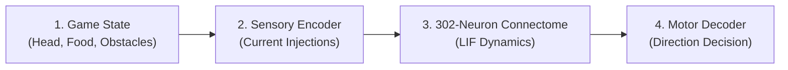

# How NeuroWorm Snake Works

A plain-language guide to how a 302-neuron simulated worm brain controls a game of Snake.

---

## The 4-Box Architecture

At every game tick, information flows through four modular stages:

### 1. Game State
The game tracks the snake's head coordinate `(x, y)`, the target food egg `(fx, fy)`, and all occupying body segment positions on a 20×20 grid.

### 2. Sensory Encoder (`simulation/sensory_encoder.py`)
The game state is translated into physical electrical currents (nanoamps) injected directly into sensory neurons:
- **Food Gradient**: The relative angle to the egg determines current injected into Chemosensory neurons **`ASEL`** (food to the left) or **`ASER`** (food to the right), amplified by olfactory neurons **`AWAL`** and **`AWAR`**.
- **Danger Detection**: If a wall or body segment is directly in front or adjacent, polymodal nociceptors **`ASHL`** and **`ASHR`** receive strong depolarizing current. An immediate obstacle straight ahead stimulates anterior touch neurons **`AVM`**, **`ALML`**, and **`ALMR`**.

### 3. Biological Nervous System (`simulation/lif_network.py` & `simulation/synaptic_circuit.py`)
All 302 neurons are simulated in parallel using a **Leaky Integrate-and-Fire (LIF)** model:
- Each neuron maintains an electrical membrane voltage resting at −65 mV.
- Injected currents and incoming synaptic spikes push the voltage toward a −55 mV threshold.
- When threshold is reached, the neuron emits a spike (action potential), resets to −70 mV, and enters a 2 ms refractory period during which it cannot fire again.
- Spikes propagate across **3,709 chemical synapses** and **1,105 electrical gap junctions**.
- For each game frame, the simulation advances by **8 timesteps** (0.5 ms each, representing 4.0 ms of biological time).

### 4. Motor Decoder (`simulation/motor_decoder.py`)
Spike counts accumulated during the frame are read from command and motor neurons:
1. **Emergency Reversal Check**: If reversal interneurons (**`AVAL`** / **`AVAR`**) fire significantly faster than forward locomotion interneurons (**`AVBL`** / **`AVBR`**), the snake triggers an evasive 90° turn.
2. **Dorsal / Ventral Split**: Dorsal motor neurons (**`DB`**) trigger an **UP** turn, while ventral motor neurons (**`VB`**) trigger a **DOWN** turn.
3. **Head Steering**: Differential activity between left head motor neuron **`SMDDL`** and right head motor neuron **`SMDDR`** drives **LEFT** vs **RIGHT** movement.
4. **Default**: If no signal exceeds the activation threshold, the snake continues in its current heading.

---

## Neuroevolution: How the Genetic Algorithm Works

Rather than using machine-learning backpropagation, the project uses a **Genetic Algorithm (GA)**:
1. **Population**: 10 individual worms are simulated in parallel.
2. **Genome**: Each worm possesses a 36-gene chromosome. Each gene represents the physical synaptic conductance (weight in nanoSiemens) of a key biological pathway (such as `ASEL -> AIYL` for food-seeking or `AVM -> AVAL` for collision reflex).
3. **Multi-Seed Evaluation**: Every generation, each candidate worm is evaluated across 5 distinct game seeds (`42, 107, 219, 333, 512`) to ensure robust foraging rather than memorization.
4. **Selection & Elitism**: The top 3 champion worms are preserved intact (elitism). The remaining 7 slots are repopulated by mutated variants of the champions with Gaussian weight perturbations.

---

## What You See on Screen

The interface provides real-time visibility into the physical environment and internal neural states of the swarm:

### Arena Visuals
- **Bacterial Egg & Scent Rings**: The nutrient spore glows brightly in the soil, encircled by 3 concentric diffusion rings that visualize the chemical scent gradient detected by `ASEL` and `ASER` chemosensory neurons.
- **Hero Worm & Swarm Ghosts**: The currently focused worm (by default, the population leader) is rendered at 100% opacity with a radiant cyan halo, segmented organic tapering, and dynamic photoreceptor eyes. The other 9 swarm candidates are rendered as translucent ghosts (~35% opacity) with minimal numeric tags to preserve visual clarity.
- **Whisker Proximity Rays**: Three sensory whiskers radiate from the hero worm's head (front, left, right). They project to the nearest wall or body obstacle, clamped strictly to the inner wall boundary. As danger approaches within 2 cells, rays dynamically transition from muted blue to amber and critical red with exact distance tags (`wall 2`, `self 1`).
- **Hunger Gauge Arc**: A circular arc surrounding the hero worm's head tracks the 150-step metabolic starvation timer. It slowly depletes as steps elapse without food, turning vibrant red when under 20% stamina remaining.
- **Death Bursts & Cause Labels**: Upon termination, a brief red dissipation burst marks the head location and a floating label identifies the exact failure cause:
  - `hit the wall`: Navigated into the stone boundary.
  - `bit itself`: Tangled with its own vermiform body segment.
  - `starved`: Ran out of steps without consuming an egg.
  - `x time` / `timeout`: Exceeded the generation step limit (400 steps).

### Control & Telemetry Panel
- **Live Thoughts Strip**: Displays real-time sensory inputs (smell balance, nose touch clear/danger), command neuron outputs (crawl forward vs evasive turn), and motor steering muscle activations (left vs right), synthesized into a plain-English status sentence.
- **Synapse Learning Tab**: A secondary tab showing the top 4 evolved biological circuits with live synaptic conductance meters in nanoSiemens (nS).
- **Swarm Leaderboard**: Ranks the top 5 worms (and focused worm) by eggs eaten and survival steps, annotated with color chips and real-time status/cause icons (`alive`, `x wall`, `x starved`, etc.).
- **"Is It Learning?" Line Chart**: A dual-line history chart plotting the generation's highest egg score (yellow) and average swarm score (cyan) across generations with labeled axes.

